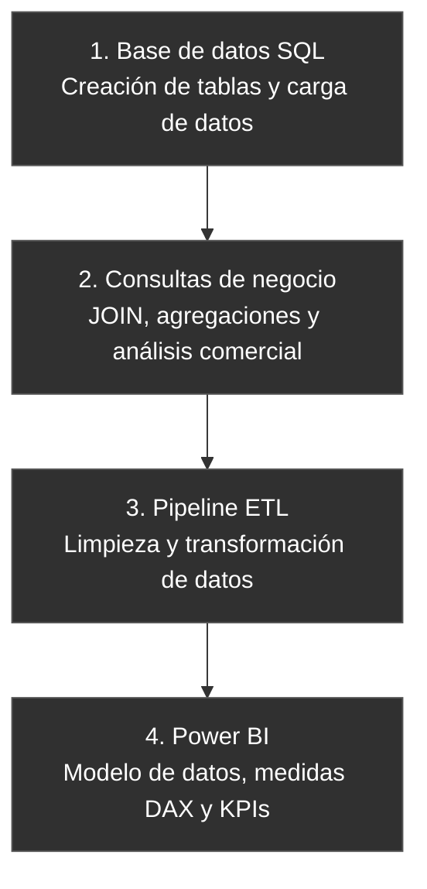

# RETAIL-PRO-GENERACION-DE-README

## Arquitectura y flujo de trabajo

El proyecto RetailPro se desarrolla en cuatro etapas principales, desde la creación de la base de datos hasta el análisis de indicadores comerciales en Power BI.

