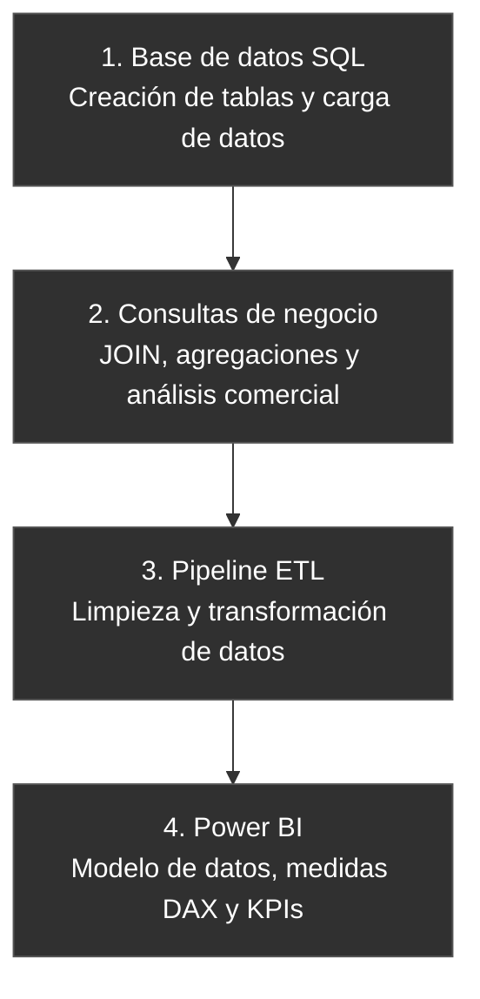

RetailPro --- Proyecto de Data Analytics
Autor: Mariano Lombardo
Área: Data Analytics / Business Intelligence
Herramientas principales: SQL, Power BI, Power Query, DAX y GitHub
Descripción del proyecto
RetailPro es un caso de análisis comercial de una distribuidora de
tecnología. El proyecto busca transformar datos de ventas, clientes y
productos en información útil para comprender el desempeño del negocio,
detectar tendencias y apoyar decisiones comerciales.

El proyecto RetailPro se desarrolla en cuatro etapas principales, desde la creación de la base de datos hasta el análisis de indicadores comerciales en Power BI.

Entre las preguntas que orientan el análisis se encuentran:
- ¿Cómo evolucionan las ventas a lo largo del tiempo?
- ¿Qué productos y categorías concentran más ventas?
- ¿Qué canales de comercialización tienen mayor participación?
- ¿Cómo se comportan las ventas por cliente y segmento?
- ¿Por qué puede aumentar la facturación sin que aumente en la misma
  proporción la rentabilidad?
Objetivos
- Organizar la información comercial en tablas relacionadas.
- Practicar consultas SQL de análisis y combinación de datos.
- Detectar y tratar problemas de calidad de datos durante el ETL.
- Construir un modelo de datos para análisis en Power BI.
- Definir y validar indicadores de negocio mediante DAX.
- Documentar el proceso y mantener las entregas versionadas en GitHub.

### Herramientas y etapas del proyecto

El proyecto RetailPro se desarrolló mediante un proceso de análisis de datos dividido en distintas etapas. Para las cuales se utilizaron distintas herramientas

**1. Creación de la base de datos:** se utilizó SQL para crear las tablas, establecer las relaciones entre clientes, productos, categorías y ventas, y cargar los datos iniciales.

**2. Consultas y análisis comercial:** se utilizó SQL para realizar consultas de negocio, aplicar funciones de agregación y combinar tablas mediante `JOIN`. Esto permitió explorar la información y responder preguntas relacionadas con el desempeño comercial.

**3. ETL y transformación de datos:** se utilizó Power BI Desktop, a través de Power Query, para importar, limpiar y transformar los datos antes de su análisis. Excel se utilizó como fuente de datos cuando correspondía al flujo de trabajo.

**4. Modelado y análisis en Power BI:** se trabajó con las relaciones entre tablas y se utilizaron medidas DAX para calcular indicadores comerciales, como ventas totales, crecimiento mensual, ventas por canal y ticket promedio por subcategoría.

**5. Documentación y control de versiones:** se utilizó GitHub para almacenar y organizar los archivos de las distintas entregas, y Markdown para documentar el proyecto mediante el archivo README.

En conjunto, estas herramientas permitieron recorrer las principales etapas de un proyecto de Data Analytics: desde la organización y consulta de los datos hasta su transformación, modelado y utilización para obtener información relevante para el negocio.

## Herramientas y tecnologías por entrega

| Orden | Repositorio / archivo | Herramientas y tecnologías |
|---:|---|---|
| 1 | [ENTREGA3](https://github.com/MLOMBARDO-cell/ENTREGA3) — `ENTREGA 3.sql` | SQL — **MySQL** |
| 2 | [m4_consultas_negocio](https://github.com/MLOMBARDO-cell/m4_consultas_negocio) — `m4_consultas_negocio.sql` | SQL — **Microsoft SQL Server (T-SQL)** |
| 3 | [ENTREGA-5](https://github.com/MLOMBARDO-cell/ENTREGA-5) — `m5_consultas_joins.sql` | SQL — **Microsoft SQL Server (T-SQL)** |
| 4 | [Pipeline_ETL_Lombardo_Mariano](https://github.com/MLOMBARDO-cell/Pipeline_ETL_Lombardo_Mariano) — archivo `.pbix` | Power BI Desktop, Power Query |
| 5 | [ENTREGA-8](https://github.com/MLOMBARDO-cell/ENTREGA-8) — `Pipeline_ETL_Lombardo_MarianoTP8.pbix` | Power BI Desktop, Power Query, DAX |
| 6 | Todos los repositorios | GitHub, Markdown |

Repositorios y entregas
  Etapa                   Repositorio                                                                                        Contenido
  Entrega 3 --- Base de   ENTREGA3                                             ENTREGA 3.sql: creación de la base
  datos                                                                                                                      Ventas_Tech_DB, tablas, relaciones,
                                                                                                                             datos de ejemplo y consultas de
                                                                                                                             verificación.

  Módulo 4 --- Consultas  m4_consultas_negocio                     Consultas SQL para explorar la información
  de negocio                                                                                                                 comercial y obtener métricas de negocio.

  Entrega 5 --- JOINs     ENTREGA-5                                           m5_consultas_joins.sql: combinación de
                                                                                                                             ventas con clientes y productos, búsqueda
                                                                                                                             de clientes o productos sin ventas y otros
                                                                                                                             análisis relacionales.

  Entrega 6 --- ETL       Pipeline_ETL_Lombardo_Mariano   Archivo de Power BI asociado al flujo de
                                                                                                                             preparación y transformación de datos.

  Entrega 8 --- Modelo y  ENTREGA-8                                           Pipeline_ETL_Lombardo_MarianoTP8.pbix:
  medidas                                                                                                                    continuación del trabajo en Power BI, con
                                                                                                                         modelo, medidas y validaciones analíticas.
Modelo de datos
El script inicial define cuatro entidades principales:
- categorias: clasificación de los productos.
- productos: catálogo, categoría, precio, stock y estado del
  producto.
- clientes: datos identificatorios y de registro de los
  clientes.
- ventas: operaciones comerciales, cliente, producto, cantidad,
  precio unitario y fecha.
Las relaciones principales conectan productos con categorías, y ventas
con clientes y productos mediante claves foráneas. Este diseño permite
analizar las operaciones sin repetir toda la información descriptiva en
cada registro de venta.

Importante: la estructura concreta de tablas y columnas puede variar
entre entregas. Antes de ejecutar una consulta, verificá que el esquema
de la base coincida con los nombres usados en ese archivo.
Cómo ejecutar los scripts SQL
1. Preparar el entorno
1. Cloná o descargá los repositorios desde los enlaces de la sección
   anterior.
2. Identificá el motor SQL instalado.
3. Abrí la herramienta correspondiente:
   - SQL Server: SQL Server Management Studio (SSMS) o Azure Data
     Studio.
   - MySQL: MySQL Workbench.
4. Revisá el script antes de ejecutarlo, en especial las instrucciones
   CREATE DATABASE, DROP TABLE, USE y la sintaxis de creación de
   tablas.
2. Crear y cargar la base
En la entrega 3, el archivo se llama ENTREGA 3.sql y utiliza el nombre
de base Ventas_Tech_DB.

El script contiene instrucciones para crear tablas, insertar datos de
ejemplo y consultar las tablas para verificar la carga. Sin embargo, usa
sintaxis de MySQL (AUTO_INCREMENT, TINYINT(1)) y no es directamente
compatible con SQL Server tal como está escrito.

Procedimiento recomendado:
1. Elegí el motor SQL que vas a utilizar.
2. Adaptá el script de creación de tablas a ese motor. Para SQL Server,
   por ejemplo, AUTO_INCREMENT debe convertirse a IDENTITY(1,1) y
   deben revisarse los tipos de datos y las instrucciones de creación
   de la base.
3. Ejecutá la sección de creación de tablas y luego la carga de datos.
4. Ejecutá los SELECT de verificación que aparecen al final del
   archivo.
5. Confirmá que las tablas tengan registros antes de pasar a las
   consultas analíticas.
Precaución: el script inicial incluye DROP TABLE IF EXISTS.
Volver a ejecutarlo puede eliminar y recrear las tablas, perdiendo
cambios o datos que hayas agregado. Usalo solamente en una base de
práctica o después de respaldar la información.

3. Ejecutar las consultas de negocio
Abrí el archivo m4_consultas_negocio.sql del repositorio
m4_consultas_negocio.
- Conectate a la instancia donde está la base de datos.
- Seleccioná la base correcta.
- Verificá que los nombres de tablas y columnas coincidan con el
  esquema disponible.
- Ejecutá las consultas individualmente para revisar los resultados y
  detectar errores con mayor facilidad.
Estas consultas están orientadas a explorar los datos y responder
preguntas comerciales. Revisá los comentarios de cada bloque para
conocer el objetivo de la consulta.
4. Ejecutar las consultas con JOIN
En el repositorio
ENTREGA-5, abrí
m5_consultas_joins.sql.

El archivo incluye ejemplos de:
- INNER JOIN para relacionar ventas con clientes y productos.
- Cálculo del importe de una línea a partir del precio unitario y la
  cantidad.
- LEFT JOIN junto con IS NULL para identificar clientes o
  productos que no tienen ventas asociadas.
- Consultas adicionales para practicar la combinación de entidades.
El script utiliza el esquema dbo y USE Ventas_Tech_DB, propios del
entorno de SQL Server. Antes de ejecutarlo, asegurate de que la base
exista en esa instancia y de que sus tablas tengan las columnas
esperadas.
Orden de ejecución sugerido
1. Entrega 3: crear y cargar la base de datos, previa adaptación al
   motor elegido.
2. Módulo 4: ejecutar las consultas de negocio.
3. Entrega 5: ejecutar las consultas con JOIN.
4. Entrega 6: abrir el archivo de Power BI y revisar el proceso
   ETL.
5. Entrega 8: abrir el archivo de Power BI para revisar el modelo,
   las medidas y las validaciones.
Las entregas de Power BI se abren con Power BI Desktop; no se
ejecutan desde el editor SQL.
ETL, modelo analítico e indicadores
En las entregas de Power BI, el trabajo continúa con la preparación de
datos mediante Power Query, la definición de relaciones entre tablas y
la creación de medidas DAX.

## KPIs e indicadores comerciales

En la entrega 8 se trabajó con Power BI para construir medidas DAX orientadas al análisis temporal de las ventas. Se incorporó una matriz de validación por año y mes para comprobar el comportamiento de los indicadores antes de utilizarlos en el análisis comercial.

| KPI / Medida | Descripción | Análisis que permite realizar |
|---|---|---|
| **Total Ventas** | Importe total de ventas del período seleccionado. | Identificar el volumen de facturación y utilizarlo como referencia para las comparaciones temporales. |
| **Ventas YTD (Year to Date)** | Ventas acumuladas desde el inicio del año hasta la fecha seleccionada. | Evaluar la evolución acumulada de las ventas durante el año. |
| **Ventas LY (Last Year)** | Ventas correspondientes al período equivalente del año anterior. | Comparar el desempeño actual con el período comparable del año previo. |
| **% Crecimiento Anual** | Variación porcentual de las ventas respecto del período comparable del año anterior, según la definición de la medida DAX. | Identificar aumentos o disminuciones de la facturación interanual. |

### Validación de las medidas

Se utilizó una matriz con **Año/Mes** en las filas y las medidas Total Ventas, Ventas YTD, Ventas LY y % Crecimiento Anual en los valores. Esta validación permite comprobar que los cálculos respondan correctamente al contexto temporal.

### Insights comerciales que se pueden obtener

- **Evolución acumulada:** Ventas YTD permite evaluar cómo se acumula la facturación a medida que avanza el año.
- **Comparación interanual:** Ventas LY proporciona una referencia histórica para analizar el desempeño del período actual.
- **Variaciones en las ventas:** el porcentaje de crecimiento anual permite identificar períodos con variaciones positivas o negativas respecto del año anterior.
- **Consistencia de los indicadores:** la matriz de validación ayuda a detectar posibles errores en las medidas temporales antes de interpretar los resultados comerciales.

Los insights representan posibilidades de análisis a partir de los indicadores implementados. Las conclusiones sobre el desempeño real del negocio deben establecerse a partir de los valores observados en el informe. 
#Validaciones recomendadas
Antes de considerar terminado el análisis:
- Comprobar que las claves foráneas relacionen registros existentes.
- Revisar que las cantidades, precios y fechas sean válidos.
- Verificar si existen clientes, productos o ventas duplicados.
- Contrastar los totales de SQL con los indicadores de Power BI.
- Probar los indicadores con distintos períodos y filtros.
- Confirmar que las medidas temporales respondan correctamente al
  calendario y al contexto de filtro.
Cómo abrir los archivos de Power BI
1. Instalá Power BI Desktop.
2. Descargá el archivo .pbix desde el repositorio de la entrega
   correspondiente.
3. Abrilo en Power BI Desktop.
4. Si se solicita, actualizá las rutas de los archivos de origen y las
   credenciales de conexión.
5. Usá Actualizar para volver a cargar los datos.
6. Revisá las relaciones, medidas y visualizaciones antes de
   interpretar los resultados.
Alcance y estado
Este repositorio reúne entregas académicas progresivas de un mismo caso
de análisis. Los scripts SQL y los archivos .pbix se encuentran
distribuidos en repositorios separados; por eso, los nombres de tablas,
el motor SQL y las fuentes de datos deben verificarse en cada etapa
antes de reproducir el flujo completo.
Autor
Mariano Lombardo
Proyecto académico de Data Analytics.
